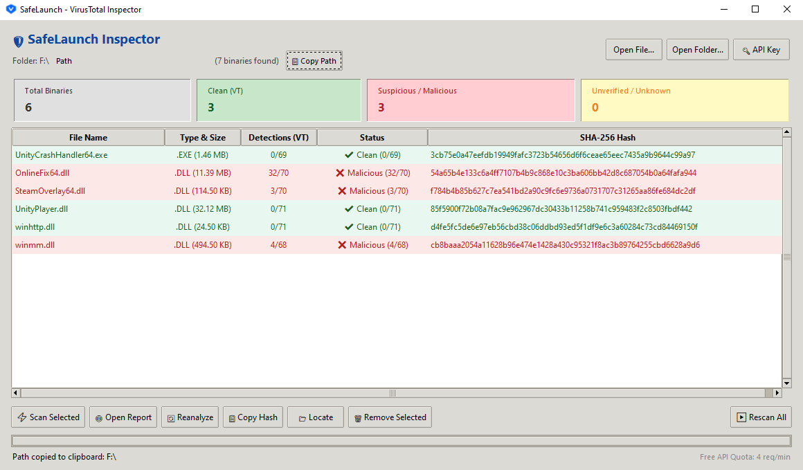

<div align="center">

  

  # SafeLaunch

  **Lightweight, Zero-Dependency Windows Context Menu Security Inspector**

  Developed with passion by **Sajed Tech**

  [](LICENSE)
  [](https://github.com/SajedTech/SafeLaunch/releases/latest)
  [](https://www.python.org/)
  [](https://docs.virustotal.com/reference/overview)

</div>

---

<div align="center">
  
</div>

## ⚡ Overview

**SafeLaunch** is a high-speed, lightweight Windows security utility designed to inspect suspicious files and executable folders before execution. Integrated seamlessly into the Windows Explorer Context Menu (Right-Click), SafeLaunch automatically extracts root executables (`*.exe`, `*.dll`), computes SHA-256 hashes, and queries the **VirusTotal v3 API** headlessly without cluttering your browser with tabs.

---

## 🛠 Key Features

- 📂 **Windows Context Menu Integration**: Right-click any file, folder, or folder background to instantly inspect binaries.
- 🖱️ **Built-In Context Menu Self-Detection & In-App Manager**:
  - Automatically detects if the Explorer right-click integration is installed on startup and offers 1-click activation.
  - Dedicated **`[ 🖱️ Context Menu ]`** button in the header allows you to install, repair, or uninstall context menu entries directly inside the application without running batch files.
- ⚡ **Headless VirusTotal v3 API Lookups**: Queries detection metrics silently in the background with zero browser tab spam.
- 🚀 **Native Drag & Drop & Clipboard Paste**:
  - Drag and drop any file or directory directly into the window.
  - Paste files or clipboard paths with <kbd>Ctrl</kbd> + <kbd>V</kbd> or via the **`[ 📋 Paste Target ]`** button.
  - Non-destructive append mode: newly added files are queued alongside existing ones.
- ⏹ **Instant Stop / Cancel Mechanism**:
  - Dynamic **`[ ⏹ Stop Scan ]`** button powered by `threading.Event()` cancels active queries and cooldowns in **0 ms**.
  - Global <kbd>Escape</kbd> shortcut to halt the scanning queue immediately.
- 🎯 **Selective API Scanning**:
  - Use **`[ ⚡ Scan Selected ]`** to inspect specific files, preserving your free API rate-limit quota.
- ⏱ **Smart Rate-Limit Engine**:
  - Sliding-window cooldown manager for the VirusTotal free tier (4 req/min) with a visual countdown badge.
- 🛡 **Zero False Sense of Security**:
  - Accurate status bar distinguishing verified clean files from unverified or skipped targets.
- 🖱 **Multi-Row Operations**:
  - Bulk report opening in browser and multi-hash clipboard copying via <kbd>Ctrl</kbd>+Click or <kbd>Shift</kbd>+Click.
- 🗑 **Table Management**:
  - Remove verified files from the list using <kbd>Delete</kbd>, <kbd>Backspace</kbd>, or toolbar buttons with real-time counter updates.

---

## 📥 Installation & Download

Download the latest pre-compiled binaries from the **[Releases Page](https://github.com/SajedTech/SafeLaunch/releases/latest)**.

### Option 1: In-App 1-Click Activation (Recommended)
1. Download and run **`vt_checker.exe`** directly.
2. If not yet installed, SafeLaunch automatically prompts you on first launch to enable the Right-Click menu in one click.
3. You can also click **`[ 🖱️ Context Menu ]`** in the top-right header at any time to Install, Repair, or Remove the integration directly inside the app.

### Option 2: Automated Batch Scripts
- Run **`install.bat`** to deploy to `%LOCALAPPDATA%\VirusTotalChecker` and register context menu keys.
- Run **`uninstall.bat`** at any time to cleanly remove registry keys from `HKEY_CURRENT_USER`.

---

## 💻 Tech Stack

- **Core Runtime**: Python 3 (Tkinter GUI, Native Win32 Subclassing)
- **Windows Integration**: `winreg`, `ctypes` (64-bit safe prototypes), `CF_HDROP`
- **Interactivity**: `windnd` (Native Win32 drag-and-drop event handling)
- **Threat Intelligence**: VirusTotal v3 REST API (Sliding window rate-limiter)
- **Distribution**: Standalone windowless executable compiled via PyInstaller

---

## ⚙️ Building from Source

```cmd
# 1. Clone repository
git clone [https://github.com/SajedTech/SafeLaunch.git](https://github.com/SajedTech/SafeLaunch.git)
cd SafeLaunch

# 2. Install dependencies
pip install windnd pyinstaller

# 3. Build standalone executable
build.bat
```

The compiled executable will be generated inside the `dist/` directory.

---

## ⚠️ Security & Educational Disclaimer

This software is developed strictly for **educational, defensive, and security research purposes**. 

- **False Positives Note**: Game modifications, emulators, and cracked binaries frequently trigger high detection ratios on VirusTotal due to code-obfuscation (packers/cryptors), memory modification hooks, and DRM-bypass techniques. A high score does not always guarantee an active Trojan, nor does a `0/70` guarantee absolute safety against brand-new or zero-day threats.
- **Liability**: The author assumes no responsibility for any misuse, system damage, or security breaches resulting from opening or executing untrusted files analyzed by this tool.

---

## 📜 License

Distributed under the **MIT License**. See the [LICENSE](LICENSE) file for more information.